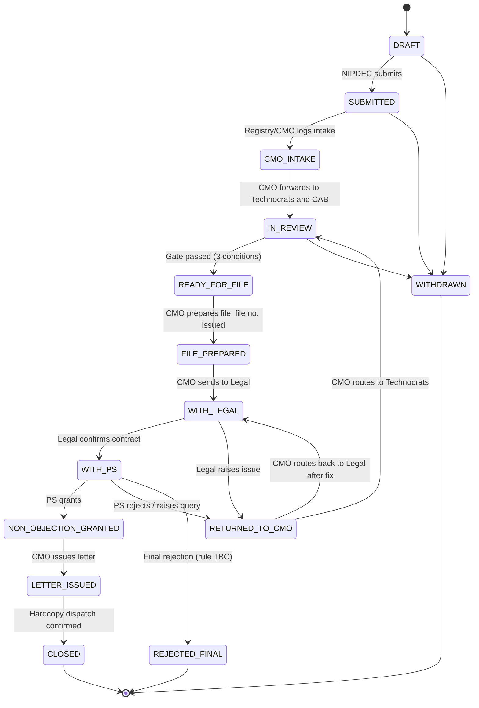
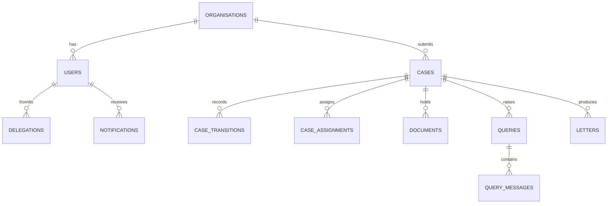
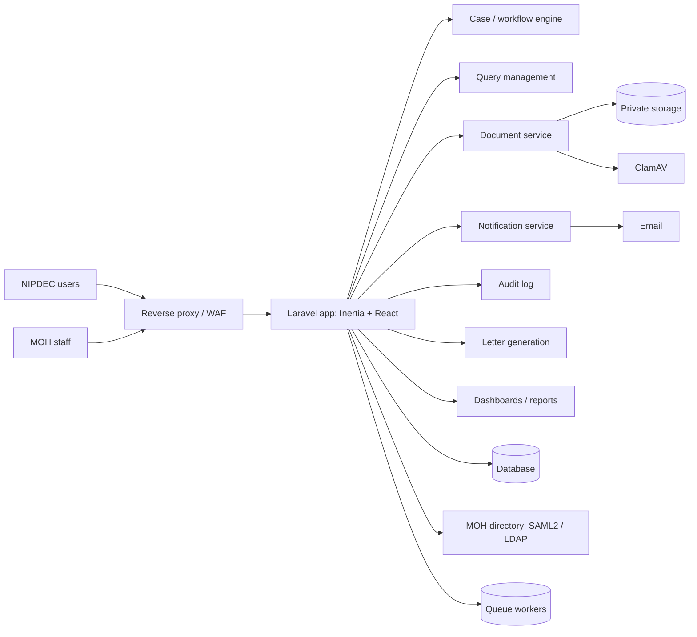

# NIPDEC Non-Objection Request System: Technical Specification

| | |
|---|---|
| **Document status** | Draft v0.1 for stakeholder review |
| **Date** | 2026-11-11 |
| **Owner** | Kyle, IT Analyst/Programmer, Ministry of Health (MOH), Trinidad and Tobago |
| **Audience** | Developers, CMO's Office, Technocrats, CAB, Legal Unit, PS Office, MOH ICT management |
| **Basis** | Current-state process diagram dated 4/11/2026 ("NIPDEC Non-Objection Request: Procurement of Medical Supplies, Pharm and non-Pharm"), plus design decisions agreed during planning |

> **How to read this document.** Statements marked **[Decided]** were agreed during planning. Statements marked **[Assumption]** are working assumptions that must be confirmed with the CMO's Office before the transitions table is frozen. Section 18 lists every open question in one place.

---

## Table of contents

1. [Purpose and scope](#1-purpose-and-scope)
2. [Background: the current process](#2-background-the-current-process)
3. [Goals, non-goals and constraints](#3-goals-non-goals-and-constraints)
4. [Actors and roles](#4-actors-and-roles)
5. [Functional requirements](#5-functional-requirements)
6. [Workflow and state machine](#6-workflow-and-state-machine)
7. [Query management and routing](#7-query-management-and-routing)
8. [Authentication and authorisation](#8-authentication-and-authorisation)
9. [Data model](#9-data-model)
10. [Document management](#10-document-management)
11. [Notifications](#11-notifications)
12. [CMO dashboard and role dashboards](#12-cmo-dashboard-and-role-dashboards)
13. [Security architecture](#13-security-architecture)
14. [System architecture and technology stack](#14-system-architecture-and-technology-stack)
15. [Non-functional requirements](#15-non-functional-requirements)
16. [Testing strategy](#16-testing-strategy)
17. [Delivery plan](#17-delivery-plan)
18. [Open questions and risks](#18-open-questions-and-risks)
19. [Glossary](#19-glossary)

---

## 1. Purpose and scope

### 1.1 Purpose

This document specifies a web application for the **Ministry of Health (MOH)** that digitises the procurement of medication (drugs), through the **NIPDEC Non-Objection Request** process. NIPDEC is an external **vendor**. It submits a request to the Ministry for a non-objection. The request passes through the Chief Medical Officer's (CMO) Office, technical reviewers, cost and budgeting, the Legal Unit and the Permanent Secretary (PS) before a non-objection letter is issued to the vendor.

The application is owned and operated by the Ministry. NIPDEC is an outside party with limited, case-scoped access.

Today the process runs on email and hardcopy. This gives no real-time visibility of where a file is, no measurement of how long each stage takes, and no central audit trail.

### 1.2 In scope

- Submission of non-objection requests by NIPDEC, with supporting documents.
- Routing of each request through the six-party approval chain.
- Parallel technical and funding review, and enforcement of the pre-file gate.
- Query handling between parties (technical, legal, PS-technical, PS-legal) under defined routing rules.
- Tracking of the physical hardcopy that must accompany each digital submission.
- File-number generation, non-objection letter generation, and letter verification.
- Notifications, audit logging, reporting, and role-specific dashboards.
- Authentication for MOH staff and for external NIPDEC users.

### 1.3 Out of scope (initial release)

- General-purpose chat or messaging outside a case.
- Digital signatures that replace the signed hardcopy letter (see 13.6).
- Federation with a NIPDEC identity provider.
- Integration with procurement, finance or tendering systems.
- Access for vendors other than NIPDEC (NIPDEC only, for now). The data model keeps room for other vendors.

---

## 2. Background: the current process

The process diagram has one main process and three query sub-processes, all in swim lanes: NIPDEC, Office of the CMO, Technocrats (DID/CFDD), Cost and Budgeting (CAB), Legal Unit, and the Permanent Secretary.

### 2.1 Main process (current state)

1. **NIPDEC** submits the application by email and hardcopy (hardcopy within 24 hours).
2. **CMO** receives the application and forwards it to the Technocrats for technical review and to CAB for funding availability.
3. **Technocrats** review the application and decide whether a favourable consideration can be communicated.
   - If **no**, a query is sent to the CMO by email, the CMO forwards it to NIPDEC, and NIPDEC's response returns to the CMO and then the Technocrats.
   - If **yes**, the Technocrats give favourable consideration to the CMO by email.
4. **CAB** advises on funding availability, and the CMO receives confirmation by email.
5. **Gate.** The CMO may prepare the file (reference HE:8/2/50) for the PS and Legal only when all three conditions are met:
   - Funding availability confirmed.
   - Technocrats' favourable consideration given.
   - NIPDEC's hardcopy application received.
6. **Legal** receives the file and decides on contractual confirmation.
   - If **no**, a Legal query is raised (sub-process "Legal queries").
   - If **yes**, Legal prepares and submits its response on the file to the PS.
7. **PS** receives the file and decides whether non-objection is granted.
   - If **no**, a PS query is raised, either legal-related or technical (sub-processes).
   - If **yes**, the PS gives non-objection and forwards the file to the CMO.
8. **CMO** receives the non-objection, prepares the non-objection letter for NIPDEC, and sends it by email and hardcopy.

### 2.2 Problems this system addresses

| Problem | Effect today | System response |
|---|---|---|
| No single record of a case | Staff search email chains | One case record with a full movement history |
| No visibility of the current holder | Applicants and managers call to ask | Current stage and holder shown on every case |
| No stage timing | Delays cannot be located or evidenced | Timestamp on every transition; metrics derived from them |
| Hardcopy and digital copies can diverge | Mismatch and rework | Cover sheet with QR code links the hardcopy to the digital case |
| Queries get lost in email | Stalled files | Queries are first-class records with owner, age and status |
| No audit trail | Weak accountability | Append-only audit log |

---

## 3. Goals, non-goals and constraints

### 3.1 Goals

1. Give every party real-time visibility of every case they are entitled to see.
2. Enforce the process rules (gate, routing, role separation) in software.
3. Create a complete, tamper-evident audit trail.
4. Capture the data needed to set evidence-based service levels later.
5. Be safe to expose to the public internet.

### 3.2 Non-goals

- Re-engineering the approval chain. The first release digitises the **current** process. Process improvements are decided separately with the CMO's Office.
- Replacing the physical hardcopy requirement.

### 3.3 Constraints

| Constraint | Source | Implication |
|---|---|---|
| Hardcopy is mandatory | **[Decided]** Confirmed by the business | Hardcopy receipt is a hard gate, not an advisory flag |
| Public-facing deployment | **[Decided]** | Hardening is part of Phase 1 |
| MOH staff have existing accounts | **[Decided]** | Staff use SSO; no local staff passwords |
| NIPDEC identity setup unknown | **[Decided]** | Local, invite-only accounts; no federation yet |
| No existing SLAs | **[Decided]** | Collect timestamps; set SLAs after 4-6 weeks of data |
| Team stack | Existing MOH practice | Laravel, Inertia.js, React |

---

## 4. Actors and roles

### 4.1 Actors

| Actor | Organisation | Responsibility in the system |
|---|---|---|
| **NIPDEC Applicant** | NIPDEC (external vendor) | Submit requests, upload documents, answer queries, track status, download the final letter |
| **NIPDEC Admin** (Phase 4) | NIPDEC (external vendor) | Manage NIPDEC's own users |
| **CMO Registry Clerk** | MOH | Log intake, confirm hardcopy receipt, route cases |
| **CMO** | MOH | Central coordinator: forwards cases and queries, assembles the file, issues the letter |
| **Technocrat** (DID/CFDD) | MOH | Technical review, queries to NIPDEC, favourable consideration |
| **CAB Officer** | MOH | Confirm funding availability |
| **Legal Officer** | MOH | Review file, contractual confirmation, legal queries |
| **PS / PS Office** | MOH | Grant or withhold non-objection, raise queries |
| **System Admin** | MOH ICT | Users, roles, configuration, templates |
| **Auditor** | MOH | Read-only access to cases and audit logs |

### 4.2 Role principles

- Roles describe **functions**, not people. A person may hold several roles.
- Permissions are granted to roles. Code checks **permissions**, never role names.
- **No role explosion.** Cover absences with delegation (8.5), not "Acting X" roles.
- Separation of duties:
  - The CMO prepares the file but cannot grant non-objection.
  - The PS cannot confirm funding.
  - The System Admin manages users and configuration but cannot act on cases.
  - The Auditor is read-only.

---

## 5. Functional requirements

Priority: **M** = must (Phase 1-2), **S** = should (Phase 3), **C** = could (Phase 4 or later).

### 5.1 Case management

| ID | Requirement | Priority |
|---|---|---|
| FR-01 | An NIPDEC Applicant can create a draft request, attach documents, and submit it | M |
| FR-02 | The system assigns a unique case reference on submission | M |
| FR-03 | The system generates a submission cover sheet (PDF) with the case reference and a QR code | M |
| FR-04 | Registry or CMO can mark the hardcopy as received, by QR scan or manual entry, recording who and when | M |
| FR-05 | The CMO can forward a case to the Technocrats and CAB in parallel | M |
| FR-06 | The system blocks "Prepare file" until the gate conditions are met (6.4) | M |
| FR-07 | The system generates the file number (HE:8/2/50-style) when the file is prepared | M |
| FR-08 | Every status change is recorded with actor, time, from-state, to-state and reason where required | M |
| FR-09 | A case can be withdrawn, returned, or finally rejected through defined paths (6.5) | M |
| FR-10 | Cases can be searched and filtered by reference, file number, date, status, category (Pharm / non-Pharm), holder | M |

### 5.2 File tracking

| ID | Requirement | Priority |
|---|---|---|
| FR-11 | Every case shows its current stage and current holder | M |
| FR-12 | Staff see the full movement timeline; NIPDEC sees a simplified status | M |
| FR-13 | Each user has an inbox of cases awaiting their action | M |

### 5.3 Queries and messaging

| ID | Requirement | Priority |
|---|---|---|
| FR-14 | Queries are records with type, raiser, recipient, routing mode, due date and status | M |
| FR-15 | Routing follows the configurable routing table (7.2) | M |
| FR-16 | Where a route requires the CMO, the CMO must forward the message before the recipient sees it | M |
| FR-17 | Query threads are scoped to a case; there is no free-form chat | M |
| FR-18 | Each message and document is flagged internal or external; NIPDEC never sees internal items | M |
| FR-19 | The CMO is notified of direct Technocrat–NIPDEC queries and can read them | M |

### 5.4 Notifications

| ID | Requirement | Priority |
|---|---|---|
| FR-20 | In-app notifications and email on assignment, query raised, query answered, forward required, decision issued | M |
| FR-21 | In-app notification centre with read/unread state | M |
| FR-22 | Per-user notification preferences | C |

### 5.5 Letters

| ID | Requirement | Priority |
|---|---|---|
| FR-23 | The CMO can generate the non-objection letter (PDF) from a template once non-objection is granted | S |
| FR-24 | Each letter carries a verification token or QR code resolving to a public verification page | S |
| FR-25 | The CMO records that the hardcopy letter was dispatched | S |

### 5.6 Delegation, reporting and administration

| ID | Requirement | Priority |
|---|---|---|
| FR-26 | An officer or admin can delegate a role to an acting officer for a date range; every delegated action is logged as "acted as X on behalf of Y" | S |
| FR-27 | Role dashboards (section 12) | M/S |
| FR-28 | Reports exportable to Excel/PDF | S |
| FR-29 | Admin can manage users, roles, routing table, templates and SLA settings | M |
| FR-30 | SLA timers, warnings and escalations | S (after baseline data) |

---

## 6. Workflow and state machine

### 6.1 Design approach **[Decided]**

- One **main status** per case, plus **three parallel tracks** that feed the gate.
- An explicit status enum and a transitions table. No external workflow engine (for example Camunda): six actors and a few loops do not justify one.
- Open queries are an **overlay**, not a status. A case with open queries shows as "blocked by query" but keeps its main status.

### 6.2 Main statuses

| Status | Meaning | Holder |
|---|---|---|
| `DRAFT` | NIPDEC is preparing the request | NIPDEC |
| `SUBMITTED` | Submitted digitally; awaiting CMO intake | CMO Registry |
| `CMO_INTAKE` | CMO has the case and is preparing to forward | CMO |
| `IN_REVIEW` | Technical review, funding check and hardcopy receipt in progress | Technocrat / CAB / Registry |
| `READY_FOR_FILE` | Gate passed; CMO may prepare the file | CMO |
| `FILE_PREPARED` | File number issued; file assembled | CMO |
| `WITH_LEGAL` | Legal reviewing; contractual confirmation pending | Legal |
| `WITH_PS` | PS deciding on non-objection | PS |
| `NON_OBJECTION_GRANTED` | PS granted; file returned to CMO | CMO |
| `LETTER_ISSUED` | Letter sent to NIPDEC | CMO |
| `CLOSED` | Complete | none |
| `RETURNED_TO_CMO` | Rejected or raised by Legal/PS; awaiting CMO routing | CMO |
| `WITHDRAWN` | Withdrawn (terminal) | none |
| `REJECTED_FINAL` | Finally rejected (terminal; see open question Q3) | none |

### 6.3 State diagram



### 6.4 Parallel tracks and the gate **[Decided]**

Inside `IN_REVIEW`, the CMO forwards to Technocrats and CAB at the same time. Three conditions are tracked independently:

| Track | Owner | Complete when | Stored as |
|---|---|---|---|
| Technical | Technocrat | Favourable consideration given | `cases.technical_track` |
| Funding | CAB | Funding availability confirmed | `cases.funding_track` |
| Hardcopy | CMO Registry | Hardcopy physically received and logged | `cases.hardcopy_received_at` (+ `hardcopy_received_by`) |

**Gate rule.** `IN_REVIEW → READY_FOR_FILE` is allowed only when `technical_track = favourable` AND `funding_track = confirmed` AND `hardcopy_received_at IS NOT NULL`. The transition guard enforces this server-side. The UI shows three ticks.

**Track values:** `pending`, `favourable` / `confirmed`, and `query_open` (where a query blocks that track).

### 6.5 Transitions table (draft for sign-off)

| # | From | To | Allowed roles | Guard / conditions | Audit reason required |
|---|---|---|---|---|---|
| T1 | `DRAFT` | `SUBMITTED` | NIPDEC Applicant (own org) | Required documents present and scanned clean | No |
| T2 | `SUBMITTED` | `CMO_INTAKE` | CMO Registry, CMO | Intake logged | No |
| T3 | `CMO_INTAKE` | `IN_REVIEW` | CMO | Creates Technocrat and CAB assignments; tracks set to `pending` | No |
| T4 | `IN_REVIEW` | `READY_FOR_FILE` | System (automatic) or CMO | **Gate: all three tracks complete** | No |
| T5 | `READY_FOR_FILE` | `FILE_PREPARED` | CMO | File number generated | No |
| T6 | `FILE_PREPARED` | `WITH_LEGAL` | CMO | File assembled | No |
| T7 | `WITH_LEGAL` | `WITH_PS` | Legal Officer | Contractual confirmation = yes; no open Legal queries | No |
| T8 | `WITH_LEGAL` | `RETURNED_TO_CMO` | Legal Officer | Contractual confirmation = no; creates a Legal query | **Yes** |
| T9 | `WITH_PS` | `NON_OBJECTION_GRANTED` | PS / PS Office | No open PS queries | No |
| T10 | `WITH_PS` | `RETURNED_TO_CMO` | PS / PS Office | Creates a PS query (legal-related or technical) | **Yes** |
| T11 | `RETURNED_TO_CMO` | `IN_REVIEW` | CMO | Routes to Technocrats; affected track reset to `pending` **[Assumption]** | **Yes** |
| T12 | `RETURNED_TO_CMO` | `WITH_LEGAL` | CMO | Technocrat answer received and forwarded to Legal | No |
| T13 | `NON_OBJECTION_GRANTED` | `LETTER_ISSUED` | CMO | Letter generated | No |
| T14 | `LETTER_ISSUED` | `CLOSED` | CMO | Hardcopy dispatch confirmed | No |
| T15 | `DRAFT`, `SUBMITTED`, `IN_REVIEW` | `WITHDRAWN` | NIPDEC Applicant (until intake), CMO | None **[Assumption]** | **Yes** |
| T16 | `WITH_PS`, `RETURNED_TO_CMO` | `REJECTED_FINAL` | CMO (on PS instruction) | **Rule TBC (Q3)** | **Yes** |

> **Assumption A1.** After a PS query is answered, the case returns to `WITH_PS`. This path needs a transition (T17: `RETURNED_TO_CMO → WITH_PS`, CMO) that the current diagram implies but does not show. Confirm in Q2/Q3.

### 6.6 Transition enforcement pattern

Every transition runs through one service so workflow rules and access control stay in one place:

```php
final class CaseTransitionService
{
    public function transition(CaseFile $case, CaseStatus $to, User $actor, ?string $reason = null): void
    {
        $rule = TransitionRule::find($case->status, $to)
            ?? throw new InvalidTransition($case->status, $to);

        Gate::forUser($actor)->authorize($rule->permission, $case);   // role + stage + assignment
        $rule->guard($case);                                          // e.g. the gate check
        throw_if($rule->requiresReason && blank($reason), ReasonRequired::class);

        DB::transaction(function () use ($case, $to, $actor, $reason) {
            $from = $case->status;
            $case->update(['status' => $to, 'current_holder_role' => $rule->nextHolder]);
            CaseTransition::create([
                'case_id' => $case->id, 'from_status' => $from, 'to_status' => $to,
                'actor_id' => $actor->id, 'acting_for_id' => $actor->actingFor?->id,
                'reason' => $reason,
            ])
            event(new CaseTransitioned($case, $from, $to, $actor));
        });
    }
}
```

All status changes in the application must call this service. No controller updates `status` directly.

---

## 7. Query management and routing

### 7.1 Query types

| Type | Raised by | Concerns |
|---|---|---|
| `TECHNICAL` | Technocrat | Technical aspects of NIPDEC's application |
| `LEGAL` | Legal Officer | Contractual issue found in review |
| `PS_TECHNICAL` | PS | Technical issue behind a PS decision |
| `PS_LEGAL` | PS | Legal-related issue behind a PS decision |

### 7.2 Routing rules as data **[Decided]**

Routing is stored in a `query_routes` table and read by code, so the business can change it without a rewrite.

| Raised by | Goes to | Mode | CMO's role |
|---|---|---|---|
| Technocrat | NIPDEC | **Direct** | Notified; read-only watcher |
| NIPDEC (reply) | Technocrat | **Direct** | Notified |
| Legal | Technocrat | **Via CMO** | Must forward |
| Technocrat (reply to Legal) | Legal | **Via CMO** | Must forward **[Assumption]** |
| PS (legal-related) | Legal | **Via CMO** | Must forward |
| PS (technical) | Technocrat | **Via CMO** | Must forward |
| Any rejection | CMO, then Technocrats | **Via CMO** | Must forward |

### 7.3 Via-CMO behaviour

1. The raiser posts a message. It is visible to the raiser and the CMO only.
2. The CMO receives an **action item** ("Forward query").
3. The CMO forwards. The message becomes visible to the recipient, and `forwarded_by_cmo_id` is stamped.
4. The reply follows the reverse route in the table.

### 7.4 Direct behaviour

The message goes straight to the recipient. The CMO is notified and has read access but no required action. Direct queries appear in the CMO's **watchlist** so nothing goes dark.

### 7.5 Query lifecycle

`OPEN → ANSWERED → RESOLVED` (or `CANCELLED`). An open query sets the relevant track or case to "blocked by query". A case cannot pass a stage gate while a query for that stage is open (for example T7 requires no open Legal queries).

### 7.6 Visibility

Every query message and attachment has `visibility = internal | external`. NIPDEC users only ever receive `external` items. Messages from Legal, PS and the CMO are `internal` by default; only messages the CMO or Technocrat explicitly address to NIPDEC are `external`. This is the most common leak in systems like this, so it has dedicated tests (section 16).

---

## 8. Authentication and authorisation

### 8.1 Two identity paths in one application **[Decided]**

| | MOH staff | NIPDEC users |
|---|---|---|
| Account source | Existing MOH directory (SAML2 or LDAP) | Local accounts in the application |
| Creation | Provisioned on first SSO login, role assigned by Admin | **Invite-only**, created by Admin or CMO; no self-registration |
| Password | None stored locally | Strong policy, hashed (Argon2id or bcrypt) |
| MFA | Required; at minimum when outside the Ministry network | **Mandatory** TOTP plus recovery codes |
| Guard | `staff` | `external` |
| Organisation | MOH | Tied to one NIPDEC organisation record |

The staff authentication driver hides the protocol (SAML2 or LDAP) behind one interface, so the application does not care which the Ministry's directory uses (Q1).

### 8.2 Account lifecycle (NIPDEC)

1. Admin or CMO creates the invite (email, organisation, role).
2. The user receives a single-use, time-limited link.
3. The user sets a password and enrols TOTP before first access.
4. Lockout after repeated failures; rate limiting on login routes.
5. Admin can disable an account immediately; sessions are revoked.

### 8.3 Five-layer access model **[Decided]**

| Layer | Question answered | Implemented by |
|---|---|---|
| 1. Identity | Who are you, which organisation? | `users.user_type`, `org_id`, auth guard |
| 2. Role | What job do you do? | `spatie/laravel-permission` roles |
| 3. Permission | What actions can that job perform? | Permissions such as `query.forward`, `letter.generate` |
| 4. Policy | Can you do this **on this case, now**? | Laravel `CasePolicy`: permission + status + assignment/org |
| 5. Visibility | Which parts can you see? | `visibility` flag; simplified timeline for NIPDEC |

Layers 1-3 are static and seeded. Layers 4-5 are where most access bugs appear and carry the most tests.

### 8.4 Draft permission matrix

✔ = allowed (still subject to stage and assignment policy). **own** = only for their own organisation or assigned cases.

| Permission | NIPDEC | CMO Registry | CMO | Technocrat | CAB | Legal | PS Office | Admin | Auditor |
|---|---|---|---|---|---|---|---|---|---|
| Submit / resubmit request | own | | | | | | | | |
| Upload documents | own | ✔ | ✔ | ✔ | | ✔ | | | |
| Confirm hardcopy received | | ✔ | ✔ | | | | | | |
| Intake and route to review | | | ✔ | | | | | | |
| Give technical consideration | | | | ✔ | | | | | |
| Confirm funding | | | | | ✔ | | | | |
| Raise query to NIPDEC | | | | ✔ | | | | | |
| Forward queries (via CMO) | | | ✔ | | | | | | |
| Prepare file (HE:8/2/50) | | | ✔ | | | | | | |
| Contractual confirmation | | | | | | ✔ | | | |
| Grant non-objection | | | | | | | ✔ | | |
| Generate and issue letter | | | ✔ | | | | | | |
| View case timeline | own (simplified) | ✔ | ✔ | ✔ | ✔ | ✔ | ✔ | | ✔ |
| View audit log | | | ✔ | | | | | ✔ | ✔ |
| Manage users and roles | | | | | | | | ✔ | |
| Configure routes and templates | | | | | | | | ✔ | |
| Reassign / delegate | | | ✔ | | | | | ✔ | |

This is a starting draft; the CMO's Office will change cells.

### 8.5 Delegation **[Decided]**

- A `delegations` record grants a **time-boxed, role-scoped, logged** copy of permissions to an acting officer. It expires automatically.
- Every delegated action records "acted as X on behalf of Y" in the audit log and the case transition.
- No "Acting CMO" role is ever created.
- The acting officer inherits the delegator's queue, and the handover is logged.

### 8.6 Authorisation rules

- **Check permissions, never role names**, in server code: `$user->can('query.forward', $case)`.
- Policies check **permission + case status + current holder or assignment**. Example: Legal can act only when the status is `WITH_LEGAL`.
- **Scope by assignment:** a role grants the *ability*, `case_assignments` grants *access to that case*. The CMO sees every case. (Whether all Technocrats see all cases, or only their unit's, is open: Q7.)
- **External isolation:** NIPDEC users get a global scope on `org_id`, and cases use ULIDs, so cross-organisation access is impossible by construction and by ID guessing.
- Front-end permission flags (shared through Inertia props) only show or hide UI. **Every endpoint authorises independently.**

```php
// CasePolicy (excerpt)
public function forwardQuery(User $user, CaseFile $case, Query $query): bool
{
    return $user->can('query.forward')
        && $query->via_cmo
        && $query->status === QueryStatus::Open
        && ! $query->isForwarded();
}

public function grantNonObjection(User $user, CaseFile $case): bool
{
    return $user->can('case.grant_non_objection')
        && $case->status === CaseStatus::WithPs
        && ! $case->hasOpenQueriesFor('PS');
}
```

---

## 9. Data model

### 9.1 Entity overview



### 9.2 Tables

| Table | Key columns | Notes |
|---|---|---|
| `organisations` | `id`, `name`, `type` (`MOH` / `NIPDEC`) | NIPDEC is a row, so other vendors can be added later |
| `users` | `id`, `org_id`, `user_type`, `auth_source` (`sso` / `local`), `mfa_enabled`, `status` | Spatie roles attach here |
| `delegations` | `id`, `from_user_id`, `to_user_id`, `role`, `starts_at`, `ends_at`, `created_by` | Acting officers |
| `cases` | `id` (ULID), `reference_no`, `file_no`, `org_id`, `category` (`pharm` / `non_pharm`), `status`, `current_holder_role`, `technical_track`, `funding_track`, `hardcopy_received_at`, `hardcopy_received_by`, timestamps | Core entity |
| `case_transitions` | `id`, `case_id`, `from_status`, `to_status`, `actor_id`, `acting_for_id`, `reason`, `created_at` | File tracking and timeline come from this table |
| `case_assignments` | `id`, `case_id`, `role`, `user_id`, `assigned_at`, `completed_at` | Powers "waiting on me" inboxes |
| `documents` | `id`, `case_id`, `version`, `type`, `path`, `sha256`, `scan_status`, `visibility`, `uploaded_by` | Versioned; private storage |
| `queries` | `id`, `case_id`, `type`, `raised_by_role`, `raised_to_role`, `via_cmo`, `status`, `due_at`, `resolved_at` | First-class entity |
| `query_messages` | `id`, `query_id`, `author_id`, `body`, `visibility`, `forwarded_by_cmo_id`, `forwarded_at`, `created_at` | Case-scoped "messaging" |
| `query_routes` | `from_role`, `to_role`, `via_cmo`, `active` | Routing rules as data |
| `notifications` | `id`, `user_id`, `case_id`, `type`, `channel`, `read_at`, `created_at` | In-app and email |
| `sla_policies` | `stage`, `role`, `warn_after_hours`, `escalate_after_hours` | Nullable at launch |
| `letters` | `id`, `case_id`, `template_id`, `verification_token`, `issued_at`, `issued_by`, `hardcopy_dispatched_at` | QR / URL verification |
| `audit_logs` | `id`, `actor_id`, `acting_for_id`, `action`, `subject_type`, `subject_id`, `ip`, `user_agent`, `created_at` | Append-only (see 13.4) |

### 9.3 Conventions

- Primary keys on externally visible entities are **ULIDs**, never sequential integers.
- All timestamps are stored in UTC and displayed in `America/Port_of_Spain`.
- Status columns are backed by PHP enums.
- `case_transitions` and `audit_logs` are insert-only.
- Soft-deleting cases is not allowed; use `WITHDRAWN` or retention rules (13.7).

### 9.4 Reference numbers

- `reference_no`: system-generated at submission (for example `NIP-2026-0142`: prefix, year, running sequence). The exact format is for the CMO's Office to confirm.
- `file_no`: the HE:8/2/50-style reference generated when the file is prepared. Whether this is a fixed series with a running number or entered manually today is open (Q5). Generate it in a transaction with a locked counter to avoid duplicates.

---

## 10. Document management

| Rule | Detail |
|---|---|
| Storage | Private disk, never publicly web-accessible |
| Access | Short-lived **signed URLs**, issued only after a policy check |
| Types and size | Allow-listed file types and size limits, enforced server-side |
| Scanning | Every upload scanned (ClamAV) by a queued job; file invisible to everyone but the uploader until `scan_status = clean` |
| Versioning | New upload of the same document type creates a new `version`; old versions stay |
| Integrity | `sha256` recorded on upload |
| Required documents | Per-category checklist (Pharm vs non-Pharm); submission blocked until complete |
| Visibility | Each document `internal` or `external` |

The list of required documents per category is a business input not yet supplied (Q9).

### 10.1 Hardcopy cover sheet

On submission the system generates a **cover sheet PDF** containing the case reference and a QR code. NIPDEC prints it and attaches it to the hardcopy. Registry scans the QR, which opens the case and marks `hardcopy_received_at`. This links the physical file to the digital case without manual matching.

---

## 11. Notifications

### 11.1 Channels

- **In-app:** notification bell and inbox. Polling is acceptable for the MVP; websockets (Laravel Reverb) can follow.
- **Email:** queued, template-based.

### 11.2 Events

| Event | Recipient | Channels |
|---|---|---|
| Case submitted | CMO Registry, CMO | In-app, email |
| Case assigned to you | Assignee | In-app, email |
| Hardcopy received | CMO, NIPDEC applicant | In-app, email |
| Query raised | Recipient (or CMO if via CMO) | In-app, email |
| **Forward required** | CMO | In-app, email |
| Query answered | Raiser, CMO | In-app, email |
| Gate passed | CMO | In-app |
| Returned to CMO | CMO | In-app, email |
| Non-objection granted | CMO | In-app, email |
| Letter issued | NIPDEC applicant | Email, in-app |
| Case aging past threshold (Phase 3) | Holder, CMO | In-app, email |

### 11.3 Rules

- Notifications to NIPDEC contain **no internal content**. They state that something needs attention and link to the portal; they never quote internal messages.
- Email sends are queued and retried; failures are logged and visible to Admin.
- Per-user preferences are a later enhancement.

---

## 12. CMO dashboard and role dashboards

### 12.1 Principle **[Decided]**

The CMO is the router and gatekeeper, so the dashboard is an **action-first inbox with a pipeline view**, not a chart page. The first question is "what is waiting on me, and what is stuck with someone else?"

### 12.2 Components

| ID | Component | Content | Phase |
|---|---|---|---|
| A | **Needs my action** queue (core) | Rows by type: new submission, hardcopy pending, query to forward, returned to CMO, gate passed, non-objection granted; case ref, category, age in stage, one primary button; oldest first | 1-2 |
| B | Pipeline by stage | Counts per status; click for filtered list | 1-2 |
| C | Gate tracker | Per In Review case: ticks for Technical, Funding, Hardcopy, plus owner of the blocker | 1-2 |
| KPI | KPI strip | Awaiting me, aging, open queries, letters pending, average turnaround | 1-2 |
| D | Query monitor | Open queries by type and holder, age, last activity; read-only watchlist of direct Technocrat–NIPDEC queries | 2 |
| E | Stuck and aging cases | Grouped by current holder; configurable thresholds; **Nudge** button (logged) | 2-3 |
| F | Workload by officer | Open cases per officer; link to reassign/delegate | 3 |
| G | Outbound letters | Awaiting generation, issued, hardcopy dispatched | 3 |
| H | Metrics tab | Average days per stage, throughput, query rate, return rate, Pharm vs non-Pharm | 3 |

All metrics derive from `case_transitions` and `queries` timestamps; no extra capture is needed.

### 12.3 Design notes

- Default aging thresholds are configurable (starting point: 5 and 10 business days) and are tuned from real data. Show **age** first; add "overdue" flags only once baselines exist.
- **Nudge** is a templated reminder logged in the audit trail. Agree tone and frequency with stakeholders before enabling it for the PS Office.
- Build B, E and H from database views or cached aggregates refreshed by a queued job every few minutes.
- The dashboard is a **configurable widget layout per role**; the same widgets with different filters serve Technocrat, CAB, Legal and PS home screens.
- Delegation applies: an acting officer inherits the queue.

---

## 13. Security architecture

The system is public-facing, so these controls are Phase 1 scope.

### 13.1 Perimeter

- TLS only; HSTS and standard security headers.
- Reverse proxy or WAF in front of the application, with rate limiting and bot protection on authentication routes.
- Consider restricting `/admin` routes by IP or VPN.

### 13.2 Authentication and sessions

- Mandatory MFA for NIPDEC users; MFA for staff at least when outside the Ministry network.
- Account lockout, login rate limiting, session timeout, re-verify MFA for sensitive admin actions.
- Separate guards and route groups for staff and external users.

### 13.3 Authorisation and isolation

- Server-side policy checks on every endpoint.
- Global `org_id` scope for NIPDEC users plus ULIDs.
- Policy tests for every role × status × action (section 16).

### 13.4 Audit logging

- **Append-only** `audit_logs`: the application's database user has `INSERT` and `SELECT` only on this table.
- Logged: logins and failures, role and permission changes, delegations, transitions, forwards, document uploads and downloads, letter generation, configuration changes, exports.
- Each entry carries actor, acting-for (if delegated), IP and user agent.

### 13.5 Data protection

- Encrypt storage at rest and database backups.
- Signed, short-lived download URLs.
- Check whether Trinidad and Tobago data protection legislation affects what is stored about suppliers and procurements (Q10).

### 13.6 Letters and signatures

- Letters carry a verification token or QR resolving to a public page that confirms authenticity without exposing case content.
- **Digital signing is not part of launch** **[Decided]**. Confirm the legal position (for example the Electronic Transactions Act and Ministry policy) before replacing the signed hardcopy letter.

### 13.7 Retention and recovery

- Government records have retention rules; confirm periods with Ministry records management (Q11) and implement as configuration.
- Automated backups with **restore tests** on a schedule, plus a minimal disaster-recovery plan.

### 13.8 Assurance

- Dependency scanning in CI.
- Vulnerability scan and penetration test **before go-live** (this system is public-facing).
- Uptime and error alerting from day one.

---

## 14. System architecture and technology stack

### 14.1 Stack **[Decided where stated; otherwise recommended]**

| Concern | Choice |
|---|---|
| Application | Laravel, Inertia.js, React |
| MFA | Laravel Fortify (TOTP and recovery codes) |
| Roles and permissions | `spatie/laravel-permission` |
| Audit | Custom `audit_logs` table (or `spatie/laravel-activitylog` if it meets the append-only requirement) |
| Database | MySQL or PostgreSQL |
| Queues | Redis or database driver (notifications, scanning, PDFs, aggregates) |
| Storage | Private disk with signed URLs |
| Malware scanning | ClamAV via queued job |
| PDF generation | DomPDF or Browsershot (letters, cover sheets) |
| Staff SSO | SAML2 or LDAP driver behind a common interface |
| Real-time (later) | Laravel Reverb |

### 14.2 Logical components



### 14.3 Module responsibilities

1. **Case / workflow engine:** statuses, transitions table, guards, assignments (6).
2. **Query management:** routing table, forwarding, threads, visibility (7).
3. **Document service:** upload, scan, version, serve (10).
4. **Notification service:** events, channels, templates (11).
5. **Audit log:** append-only record of actions (13.4).
6. **Letter service:** template to PDF, verification token (13.6).
7. **Dashboard and reporting:** widgets, aggregates, exports (12).
8. **Admin module:** users, roles, routing, templates, SLA settings, delegation.

### 14.4 Environments

Development, staging with anonymised data and production. Infrastructure choice (for example MOH-hosted Windows Server/IIS, or a cloud host) is open (Q6 follow-up) and affects queue, scanner and backup setup.

---

## 15. Non-functional requirements

Targets below are **proposed starting points**, not agreed service levels.

| Area | Requirement |
|---|---|
| Availability | Business-hours availability prioritised; maintenance windows outside working hours |
| Performance | Dashboard and list pages respond in under 2 seconds for the expected case volume; uploads handled asynchronously |
| Scalability | Designed for the volume of NIPDEC requests; volume to be confirmed (Q12) |
| Auditability | 100% of status changes and permission changes logged |
| Accessibility | Keyboard-operable, labelled controls, sufficient contrast (target WCAG 2.1 AA) |
| Browser support | Current versions of Chrome, Edge, Firefox; responsive down to phone width |
| Time zone | Stored UTC, displayed `America/Port_of_Spain` |
| Backups | Daily at minimum; restore tested on a schedule |
| Observability | Error tracking, uptime monitoring, queue failure alerts |
| Maintainability | Permission matrix and routing table versioned in the repository (seeders/migrations) |

---

## 16. Testing strategy

| Layer | What is tested | Approach |
|---|---|---|
| Policy tests | Role × status × action → allow/deny | Table-driven (Pest/PHPUnit data providers); highest priority |
| Transition tests | Every row of the transitions table, and every illegal transition | Feature tests on `CaseTransitionService` |
| Gate tests | Each missing-condition combination blocks T4 | Exhaustive 2³ combinations |
| Routing tests | Each row of `query_routes`; via-CMO message invisible until forwarded | Feature tests |
| Visibility tests | NIPDEC never receives `internal` messages, documents, or notification content | Feature tests on every read path |
| Isolation tests | NIPDEC user A cannot read org B's case by ID, list, search or download | Feature tests |
| Auth tests | MFA required, lockout, invite expiry, disabled-account session revocation | Feature tests |
| Upload tests | Type/size limits, unscanned files hidden, infected files rejected | Feature tests with the EICAR test file |
| Delegation tests | Expiry, scope, audit attribution | Feature tests with time travel |
| Audit tests | Append-only enforced at database permission level | Integration test against DB user |
| End-to-end | Happy path and each query loop | Browser tests |
| Security | Dependency scan in CI; pre-go-live pen test | CI plus external test |
| UAT | Walkthrough with CMO's Office using real scenarios | Scripted sessions |

---

## 17. Delivery plan

### 17.1 Phases

| Phase | Scope | Outcome |
|---|---|---|
| **1: Core and hardening (MVP)** | Auth and MFA, orgs/users/roles, case submission, documents with scanning, state machine skeleton with audit log, case timeline, email notifications, WAF/rate limiting/hardening basics, CMO action queue, pipeline, gate tracker, KPI strip | Replaces email for the happy path, safe to expose |
| **2: Queries and gates** | Query loops (Technical, Legal, PS), routing table, via-CMO forwarding, gate validation, in-app notifications, hardcopy QR cover sheet and receipt, query monitor | Covers all four diagram tabs |
| **3: Control** | SLA timers and escalation (from collected baselines), delegation, role dashboards, stuck cases and Nudge, workload, letter generation with verification, reports and export | Management visibility |
| **4: Production hardening** | Penetration test fixes, retention policy, backup and restore drills, NIPDEC org admin | Production-ready |

> Security hardening is in Phase 1, not Phase 4, because the system is public-facing. Phase 4 covers verification and operational maturity.

### 17.2 Before building

1. Confirm open questions Q2-Q5 with the CMO's Office, since they affect the transitions table.
2. Review the **transitions table** (6.5) and **permission matrix** (8.4) with stakeholders. Get written sign-off.
3. Run one session with the CMO's Office on the future-state process before freezing the state machine. The diagram is labelled "current state"; digitising an inefficient process locks it in.

### 17.3 Phase 1 starter task breakdown

1. Scaffold the Laravel + Inertia + React project; CI with tests and dependency scanning.
2. Staff SSO driver and local external auth with Fortify MFA.
3. Organisations, users, roles and permissions; seeders from the matrix.
4. Case model, statuses enum, `case_transitions`, transition service skeleton.
5. Submission flow: draft, documents, required-document checklist, submit.
6. Document upload with private storage, signed URLs, ClamAV job.
7. Audit log with restricted database privileges.
8. Case timeline view (staff full, NIPDEC simplified).
9. Email notifications via queue.
10. CMO dashboard: action queue, pipeline, gate tracker, KPIs.
11. WAF, rate limiting, security headers, session policy.
12. Policy and isolation test suite.

### 17.4 SLAs

No SLAs exist. After 4-6 weeks of live timestamps, review per-stage durations and set SLA values in `sla_policies`. Enable warnings first, escalations later.

---

## 18. Open questions and risks

### 18.1 Open questions

| # | Question | Owner | Impact |
|---|---|---|---|
| Q1 | Is the staff directory AD/Entra (SAML2/OIDC possible) or LDAP only? | MOH ICT | Choice of auth driver only |
| Q2 | When Technocrats answer a Legal or PS query, does the answer return via CMO? (Assumed yes.) | CMO's Office | Routes and transitions T11/T12/T17 |
| Q3 | Can a PS rejection end the case (`REJECTED_FINAL`), or does it always loop to the CMO team? Is NIPDEC notified of a final rejection, and can it resubmit? | CMO's Office, PS | T16, resubmission path |
| Q4 | Who can mark hardcopy received: Registry only, or any CMO staff? | CMO's Office | Permission `hardcopy.confirm` |
| Q5 | Is the HE:8/2/50 file number a fixed series with running number, or entered manually? | CMO's Office | Number generator |
| Q6 | How many NIPDEC users, and does NIPDEC have an IT team or identity provider? | NIPDEC | Account model, future federation |
| Q7 | Are DID and CFDD separate Technocrat queues or one pool? | CMO's Office | Assignment scoping |
| Q8 | Can the PS delegate non-objection to a deputy, or only file preparation? | PS Office | Delegation rules |
| Q9 | What is the required-document list for Pharm and non-Pharm requests? | CMO's Office | Submission validation |
| Q10 | Does T&T data protection legislation constrain stored supplier or procurement data? | MOH Legal | Data handling |
| Q11 | What retention periods apply to these records? | Records management | Retention configuration |
| Q12 | Expected volume of cases per month? | CMO's Office | Capacity, aggregate design |
| Q13 | Can Technocrats see CAB funding details or only confirmed/not confirmed? Does Legal see the whole case or only the prepared file? | CMO's Office | Visibility rules |
| Q14 | Is there an urgent or emergency procurement path that should jump the queue? Are cases prioritised by value? | CMO's Office | Priority field |
| Q15 | Who may reassign a case when an officer is away: CMO only, or unit heads too? | CMO's Office | Permission `case.reassign` |
| Q16 | Does the CMO personally work the queue, or does a registry clerk or deputy? | CMO's Office | Default dashboard view |
| Q17 | Hosting: MOH-hosted (IIS/Windows Server) or cloud? Is the system reachable from the public internet directly or through a managed gateway? | MOH ICT | Deployment, scanner, queues |
| Q18 | The source diagram says "Pharm and non-Pharm" supplies. Is this system for drugs only, or does it also cover non-pharmaceutical medical supplies? | CMO's Office | Category field, required documents (Q9), reporting |

### 18.2 Risks

| Risk | Likelihood | Impact | Mitigation |
|---|---|---|---|
| Role/permission cells change after build | High | Medium | Matrix as seed data; policy tests; sign-off before coding |
| CMO remains a bottleneck for via-CMO routes | High | High | Routing table lets the business relax routes; dashboard surfaces forwarding backlog; delegation |
| Digitising a poor process locks it in | Medium | High | Future-state session before freezing the state machine |
| Public exposure attracts attacks | Medium | High | Phase 1 hardening, WAF, MFA, pen test before go-live |
| Hardcopy and digital copy mismatch | Medium | Medium | QR cover sheet; hardcopy gate |
| Internal content leaked to NIPDEC | Low | High | Visibility flag on every item; dedicated tests; sanitised notifications |
| User adoption: staff keep using email | Medium | High | Role dashboards; CMO sponsorship; run parallel with email for a defined period |
| Single developer capacity | Medium | Medium | Small shippable phases; strict scope control |

---

## 19. Glossary

| Term | Meaning |
|---|---|
| **NIPDEC** | The external vendor submitting non-objection requests to the Ministry of Health |
| **Non-objection** | The Ministry's formal clearance for a procurement to proceed |
| **CMO** | Chief Medical Officer; the Office of the CMO is the central coordinator |
| **Technocrats (DID / CFDD)** | MOH technical reviewers |
| **CAB** | Cost and Budgeting; confirms funding availability |
| **Legal Unit** | MOH legal reviewers; confirm contractual aspects |
| **PS** | Permanent Secretary; grants or withholds non-objection |
| **Gate** | The three conditions that must hold before the CMO prepares the file |
| **Hardcopy** | The physical copy of the application that must accompany the digital submission |
| **HE:8/2/50** | Format of the file reference generated when the file is prepared |
| **Case** | One non-objection request and its full history |
| **Query** | A tracked question between parties on a case |
| **Via CMO** | A route where the CMO must forward the message before the recipient sees it |
| **Direct** | A route where the message goes straight to the recipient and the CMO is only notified |
| **Delegation** | A time-boxed, logged grant of a role's permissions to an acting officer |
| **Policy** | A Laravel authorisation class that checks permission, case status and assignment |
| **ULID** | Non-sequential unique identifier used for externally visible records |
| **SLA** | Service-level agreement; none exist yet |

---

*End of document. Version 0.1, to be revised after stakeholder review of sections 6.5, 8.4 and 18.*
